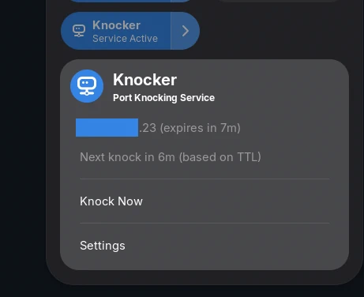

# Knocker GNOME Extension

A GNOME Shell extension for managing the [Knocker-CLI](https://github.com/FarisZR/Knocker-CLI) port knocking service.



## Features

- **Quick Settings Integration**: Easily toggle the knocker service on/off from the GNOME Quick Settings panel
- **Service Status**: Visual indicator showing when the knocker service is active (blue when on, gray when off)
- **Manual Knock Trigger**: Trigger a knock manually with a single click
- **Real-time Status**: View current whitelisted IP and expiry time
- **Upcoming Knock**: See when the next automatic knock is scheduled
- **Error Notifications**: Get notified when the service encounters errors
- **Auto-start**: Optionally auto-start the service when the extension loads

## Requirements

- GNOME Shell 48, 49, 50 or 51
- [Knocker-CLI](https://github.com/FarisZR/Knocker-CLI) installed and configured
- systemd user service `knocker.service` set up

## Installation

Install [Homebrew](https://brew.sh) on Linux, then:

```bash
brew install --cask fariszr/tap/knocker-gnome
```

This default package follows the latest tagged stable release. For the latest
commit on `main`, opt into the development channel instead:

```bash
brew install --cask fariszr/tap/knocker-gnome@main
```

The channels install the same extension and cannot coexist. To switch, uninstall
the installed cask first, then install the other. Extension preferences and the
Knocker service configuration are preserved.

Log out and back in, then enable the extension:

```bash
gnome-extensions enable Knocker@fariszr.com
```

Already installed manually? Move
`~/.local/share/gnome-shell/extensions/Knocker@fariszr.com` to a backup location
first; Homebrew will manage that directory from then on. Your extension preferences
and Knocker service configuration are preserved.

Update with:

```bash
brew update
brew upgrade --cask knocker-gnome
```

Log out and back in after an upgrade to load the new code. The CLI remains a
separate prerequisite (`brew install --cask fariszr/tap/knocker-cli`); configure
its `knocker.service` as described in the [CLI documentation](https://github.com/FarisZR/Knocker-CLI).

Every current `main` build updates the GitHub `@main` prerelease and the
`knocker-gnome@main` cask. Versioned releases update the default `knocker-gnome`
cask and GitHub’s latest stable release. Both channels are tested automatically. See [release automation](docs/PUBLISHING.md)
for the publishing process and scheduled synchronization fallback.

## Usage

### Quick Settings

After installation, you'll find the Knocker toggle in your Quick Settings panel (top-right corner):

- **Toggle Switch**: Start/stop the knocker service
- **Current IP**: Shows the currently whitelisted IP and when it expires
- **Next Knock**: Shows when the next automatic knock is scheduled
- **Knock Now**: Manually trigger a knock
- **Settings**: Open the preferences window

### Service States

- **Blue Toggle**: Service is running
- **Gray Toggle**: Service is stopped

### Notifications

The extension will show notifications for:
- Successful knocks (when enabled in settings)
- Service errors (when enabled in settings)
- Missing knocker-cli installation

## Configuration

Open the extension preferences to configure:

- **Show Indicator**: Display the Knocker icon in the panel
- **Auto-start Service**: Automatically start the service when the extension loads
- **Notify on Errors**: Show notifications for service errors
- **Notify on Successful Knock**: Show notifications when a knock succeeds

## Troubleshooting

### Extension doesn't appear

1. Check if the extension is enabled:
   ```bash
   gnome-extensions list
   ```

2. Check for errors in the logs:
   ```bash
   journalctl -f -o cat /usr/bin/gnome-shell
   ```

### Service won't start

1. Check if knocker-cli is installed:
   ```bash
   which knocker
   ```

2. Check if the knocker.service is configured:
   ```bash
   systemctl --user status knocker.service
   ```

3. Check service logs:
   ```bash
   journalctl --user -u knocker.service
   ```

## Development

See [docs/ARCHITECTURE.md](docs/ARCHITECTURE.md) for development documentation.

## License

This extension is licensed under the GPL-2.0-or-later license. See the source files for details.

## Contributing

Contributions are welcome! See [CONTRIBUTING.md](CONTRIBUTING.md) for guidelines.

## Documentation

- [Quick Start Guide](docs/QUICKSTART.md) - Get started in 5 minutes
- [Installation Guide](docs/INSTALLATION.md) - Detailed installation instructions  
- [Testing Guide](docs/TESTING.md) - Comprehensive testing procedures
- [Architecture Guide](docs/ARCHITECTURE.md) - Technical design details
- [Development Guide](docs/DEVELOPMENT.md) - For contributors
- [Publishing Guide](docs/PUBLISHING.md) - Submission to extensions.gnome.org

## Credits

- Based on the [GJS Guide](https://gitlab.gnome.org/World/javascript/gjs-guide)
- Integrates with [Knocker-CLI](https://github.com/FarisZR/Knocker-CLI) by FarisZR
